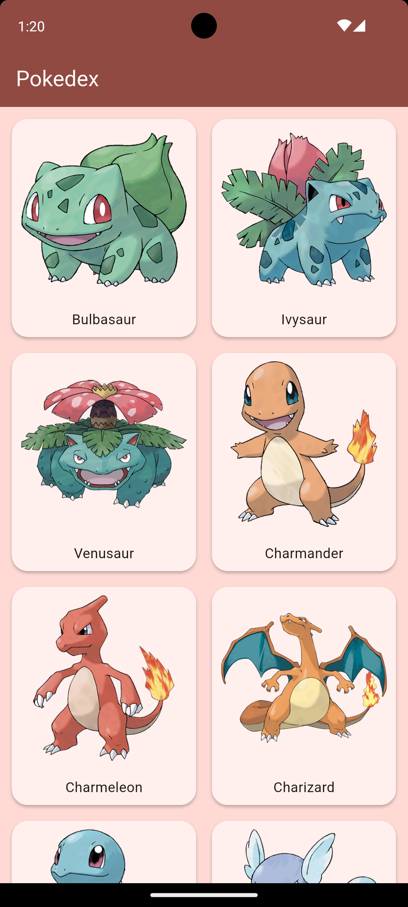
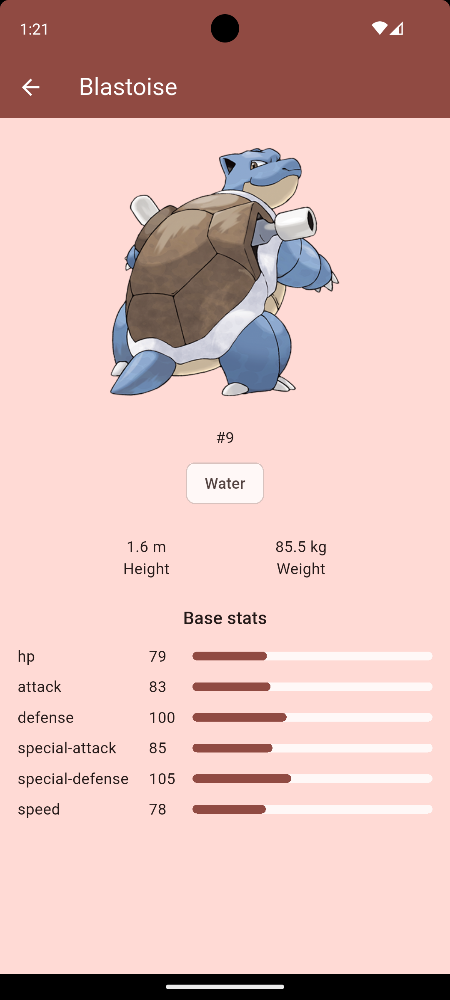
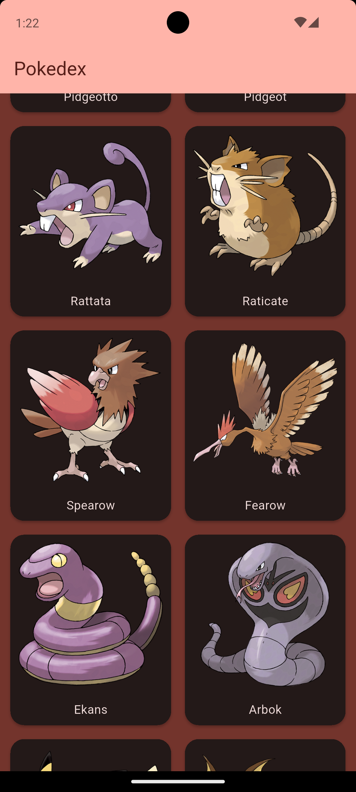
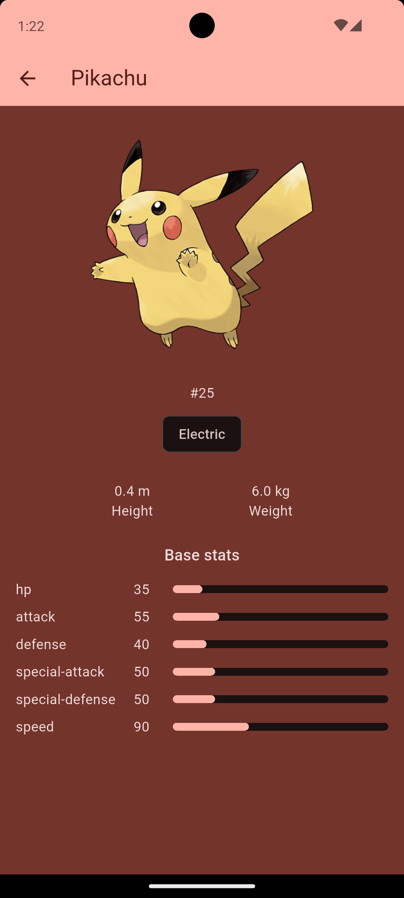

# Pokedex App

A small Flutter app that shows Pokemon from the PokeAPI. You can scroll through the list, open a Pokemon and see its details.

I made this project to practice working with a real REST API, pagination and nested JSON.

## Screenshots

| Home | Detail |
|------|--------|
|  |  |

| Home (dark) | Detail (dark) |
|-------------|---------------|
|  |  |

## Features

- Grid of Pokemon with images
- Infinite scroll, 20 more Pokemon load when you reach the bottom
- Detail screen with image, types, height, weight and base stats
- Hero animation between the card and the detail image
- Loading, error and "Retry" states
- Placeholder icon when an image fails to load
- Light and dark theme, follows the system setting

## Tech

- Flutter
- Riverpod (`AsyncNotifier`, `FutureProvider.family`)
- http
- [PokeAPI](https://pokeapi.co/)

## How it works

The list endpoint only returns a name and a url for each Pokemon. The id is taken from that url and the image url is built from the id, so the list needs only one request per page. The full details are loaded only when you open a Pokemon.

## Project structure

```
lib/
  models/       Pokemon, PokemonDetail, PokemonStat
  services/     PokemonService (http requests)
  providers/    Riverpod providers
  screens/      HomeScreen, DetailScreen
  widgets/      PokemonCard, StatBar
  theme/        light and dark theme
  utils/        small helpers
```

## Run it

No API key is needed.

```
git clone https://github.com/LukaMeletidi/pokedex_app.git
cd pokedex_app
flutter pub get
flutter run
```

## What I practiced

- Parsing nested JSON into Dart models
- Pagination with a scroll listener
- Loading, error and retry states with `AsyncValue`
- Providers with a parameter (`family`)
- Hero animations

## Note

This is a learning project. It is not connected to Nintendo or The Pokemon Company. All data comes from PokeAPI.